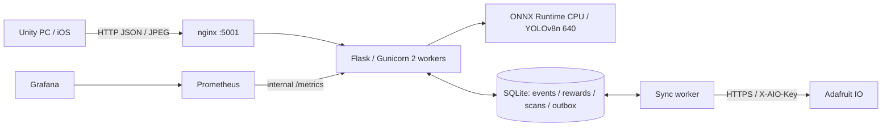

# Bản nháp báo cáo kỹ thuật backend — Minh Nhật (D2)

Ngày 2026-11-07T16:39:36.346576+07:00; mã kiểm thử `697be9883856d26f453475a9a8c8c3f133b9c75b`. Nhánh `minhnhat/docs-testing` chứa B2.6 `64b1e2b`, B2.8 `6c69def`, merge origin/main không conflict tại `697be98`. Cấu hình: YOLOv8n 640 FP32, confidence ≥0.70, pool nhiễm `cell phone,laptop,chair`. Đây là bản nháp phần backend/cloud/Docker và thư viện client của Minh Nhật; không xác nhận nghiệm thu iPhone/AR thật.

## Kiến trúc và trách nhiệm

Flask xác thực payload và xử lý contract; Gunicorn phục vụ hai worker; ONNX session được nạp một lần mỗi worker. SQLite dùng chung lưu event, reward, phiên scan và outbox. Worker sync tách tiến trình đọc SQLite và đẩy snapshot lên Adafruit. nginx không công khai `/metrics`; Prometheus scrape trực tiếp API nội bộ; Grafana truy vấn Prometheus. Unity giữ khóa cloud ngoài client. Nguồn: `Server/app/`, `Server/docker-compose.yml`, `Server/deploy/`; kiểm chứng [D2/container-config.json](Evidence/CampusGuardian/D2/container-config.json), [D2/compose-ps.json](Evidence/CampusGuardian/D2/compose-ps.json).

## Năm bước triển khai W9 và mức đáp ứng

Bảng này dùng năm bước trong skill dự án `.agents/skills/w9-onnx-pipeline/SKILL.md`, không tự coi là trích nguyên văn W9-En.pdf (PDF không có trong checkout D2). Nội dung skill cũ về đồng bộ ngay từ predict phải đọc cùng kiến trúc event/outbox hiện tại: `/predict` thông thường không tự tăng lost-found-count.

| Bước | Dự án đáp ứng | Bằng chứng / giới hạn |
|---|---|---|
| 1. Chuẩn bị môi trường/cấu hình | Python3.11, .env backend, key tách client, model/ngưỡng/pool cố định | [environment.json](Evidence/CampusGuardian/D2/environment.json), [container-config.json](Evidence/CampusGuardian/D2/container-config.json); .env không commit/không sửa |
| 2. Xuất/nạp ONNX | Có export_onnx.py và artifact YOLOv8n; runtime nạp CPUExecutionProvider | [model-runtime.txt](Evidence/CampusGuardian/D2/model-runtime.txt): input1×3×640×640/hash; D2 không chạy lại export |
| 3. Docker hóa/triển khai | Compose build/start năm container, Gunicorn hai worker, API non-root | [docker-up.txt](Evidence/CampusGuardian/D2/docker-up.txt), [compose-ps.json](Evidence/CampusGuardian/D2/compose-ps.json). **Kubernetes chưa làm**, không có cluster/manifests được kiểm chứng |
| 4. API/giám sát/suy luận | health, predict, scan/events; Prometheus và Grafana hoạt động | [http.json](Evidence/CampusGuardian/D2/http.json), [benchmark.json](Evidence/CampusGuardian/D2/benchmark.json), [prometheus-targets-stable.json](Evidence/CampusGuardian/D2/prometheus-targets-stable.json) |
| 5. Adafruit IO | Event ghi SQLite rồi outbox retry/sync; đọc năm feed thật | [cloud-fault.json](Evidence/CampusGuardian/D2/cloud-fault.json), [cloud-correct.json](Evidence/CampusGuardian/D2/cloud-correct.json), [adafruit-feeds-final.json](Evidence/CampusGuardian/D2/adafruit-feeds-final.json) |

## Model, tiền xử lý và lựa chọn 640

Model pretrained COCO YOLOv8n 640 FP32; runtime chỉ lọc sáu lớp `book,laptop,chair,bottle,backpack,cell phone`; không phải model được train riêng sáu lớp. Ngưỡng tối thiểu 0.70. Nguồn model/license Ultralytics AGPL-3.0: `Server/models/README.md`, `AGPL-3.0.txt`; SHA256 `4d0632282232a5fe4eedf59a951f371d3d6b98e4d78546813f1d0ef07b06bb40` khớp kiểm tra container.

Detector letterbox ảnh về640, chuẩn hóa RGB/CHW, chạy ONNX và decode/NMS. Encoder Unity giới hạn cạnh dài640; evaluator B2.6 xoay EXIF trước resize, không upscale. Không khẳng định HTTP backend đã tự sửa mọi EXIF camera: client phải gửi ảnh đúng hướng. Không chạy YOLOv8s hoặc đổi threshold trong D2.

Chọn640 dựa vào quyết định [model-decision.md](Evidence/CampusGuardian/B2/model-decision.md): so sánh B2 nhỏ cho thấy 416/480 bỏ sót fixture laptop nhiều hơn, không đủ cơ sở đánh đổi độ đúng chỉ để giảm độ trễ. D2 kiểm tra model cố định, không benchmark lại các size khác và không coi mẫu nhỏ là chứng minh ưu thế tổng quát.

### Độ trễ đo thật trong container

Windows host: AMD Ryzen 7 6800H with Radeon Graphics; container Linux/WSL2, CPUExecutionProvider, Gunicorn2worker và ORT8intra-op threads/worker. Một client tuần tự trong API container gọi HTTP localhost Gunicorn, 5warmup rồi50request; fixture laptop-stocksnap.jpg, không đi qua nginx. Đây không phải thử tải đồng thời hai client hoặc mạng iPhone.

| Chỉ số | p50 (ms) | p95 (ms) |
|---|---:|---:|
| API total_time_ms | 96.215 | 257.221 |
| HTTP wall (client trong container) | 98.124 | 259.300 |
| Chỉ inference | 72.582 | 213.269 |

So với B2.7 p50≤150ms/p95≤220ms cho API total: **Fail** trên phép đo này. Không đồng nhất inference với API total hoặc cam kết latency mọi máy. Nguồn raw50mẫu: [benchmark.json](Evidence/CampusGuardian/D2/benchmark.json), command tại [benchmark-command.json](Evidence/CampusGuardian/D2/benchmark-command.json).

## Đánh giá ảnh thật B2.6 → pool B2.8

Đầu bài dự kiến35ảnh nhưng thực tế36; theo xác nhận người dùng loại3ảnh gốc>5MiB (book1/book2/none3), còn33ảnh:29dương và4none. Nhãn do người dùng xác nhận theo thư mục; `cellphone` ánh xạ `cell phone`. EXIF Orientation trước RGB/resize cạnh dài≤640, không upscale; không lưu GPS/commit ảnh. Nguồn toàn bộ ảnh đo là **không rõ/ảnh mạng** vì không có EXIF điện thoại, không khẳng định ảnh tự chụp.

| Lớp | Đúng/tổng tại0.70 | Recall | Trong pool nhiễm |
|---|---:|---:|---|
| cell phone | 3/5 | 60% | Có |
| laptop | 5/5 | 100% | Có |
| chair | 4/6 | 66.7% | Có |
| book | 0/3 | 0% | Không |
| bottle | 0/5 | 0% | Không |
| backpack | 0/5 | 0% | Không |

Tổng12/29(41.4%); riêng pool12/16(75%); none0/4dương giả. Tại0.50/0.60 là15/29(51.7%), không dùng để hạ ngưỡng mặc định. Nguồn [real-eval.md](Evidence/CampusGuardian/B2/real-eval.md), raw JSON và danh sách17ảnh trượt đi kèm. Mẫu nhỏ và ảnh mạng có thể dễ hơn camera lúc chơi; không có bbox ground truth/mAP. Pool được chọn sau khi xem tập này, cần tập độc lập để đánh giá tổng quát hóa.

B2.8 giới hạn lớp có thể nhiễm ở điện thoại/laptop/ghế. Backend chọn1–2lớp, clamp theo pool; gợi ý điện thoại/laptop cùng “đồ điện tử” không lặp, ghế “thứ để ngồi”. Pool rỗng hoặc chứa lớp ngoài ALLOWED_CLASSES gây lỗi khởi động rõ ràng. `/predict` vẫn nhận sáu lớp; bottle/book/backpack được nhận diện có scan_session_id thì clean trong pool mặc định. D2 thực sự phát hiện bottle3 và trả clean; laptop trả infested ở phiên ngẫu nhiên. Phiên cũ giữ hint/TTL đã lưu; lớp ngoài pool mới không reveal thêm, cần bắt đầu phiên mới sau đổi pool. Nguồn [http.json](Evidence/CampusGuardian/D2/http.json), [pytest.xml](Evidence/CampusGuardian/D2/pytest.xml).

## API

| Endpoint | Đầu vào / kết quả |
|---|---|
| GET /health | DB/model/cloud-configured/outbox;200 khi DB khỏe,503 khi degraded; phải xem model_loaded riêng |
| POST /predict | Multipart image; target_class/threshold tùy chọn, scan_session_id tùy chọn;200 detections/target_found/timing, scan result infested/clean/none khi có phiên;400/413/503 nếu lỗi |
| POST /scan/sessions | JSON session_id UUID;201 id/hint/max_monsters/expires_at;409 phiên mở,429 cooldown/limit |
| GET /scan/sessions/{id} | Số đã reveal/còn lại, hint/expiry;404 không có,410 hết hạn; không lộ danh sách lớp nhiễm |
| POST /gameplay/events | UUID event/session, quest/milestone/type/time/payload whitelist;201 recorded,200 duplicate,409 cùng id khác payload,400 invalid |
| GET /gameplay/events/{id} | Trạng thái event/core/cloud pending/failed/synced/disabled;404 nếu không có |
| GET /metrics | Chỉ nội bộ cho Prometheus; qua nginx trả404 |

Schema và validate ở `Server/app/routes/`, `event_validation.py`; output thật tại [http.json](Evidence/CampusGuardian/D2/http.json). Không có API đăng nhập hoặc quản lý account.

## Chống trùng, thưởng và chống farm

Event UUID và canonical payload hash được lưu SQLite: replay đúng payload trả duplicate, cùng ID khác nội dung trả409. Milestone cũ thưởng một lần theo session/milestone; AR combat cần monster_token do server phát hành và đúng game session. Reveal/token, event, aggregate, reward link và outbox được ghi giao dịch; token mới dùng lại trả400, duplicate event cũ không cộng thêm. Reward `ar_monster` là10Core theo `Server/config/rewards.json`. D2 ghi201/core10, duplicate200/core10 là kết quả đã ghi chứ không cộng10lần nữa; pytest kiểm tổng aggregate/token/concurrency/rollback. Restart API vẫn duplicate. Nguồn [http.json](Evidence/CampusGuardian/D2/http.json), [pytest.xml](Evidence/CampusGuardian/D2/pytest.xml).

Mặc định một phiên đang mở mỗi game session; cooldown120giây, tối đa5phiên/game session, TTL15phút. Gửi lại khi mở→409, cooldown/limit→429, hết hạn→410. Test HTTP sidecar dùng SQLite tạm và override TTL1.2s/cooldown3s/max2 để không chờ lâu; unit tests kiểm mặc định và concurrent create. Không mô tả sidecar như cấu hình production. Không có account nên không ngăn người dùng tự tạo game-session UUID mới. Nguồn [scan-boundaries.json](Evidence/CampusGuardian/D2/scan-boundaries.json), source `scan_store.py`.

## Docker, bảo mật và giám sát

Năm container: nginx, iuh-guardian-api, iuh-guardian-sync, Prometheus, Grafana. API/nginx/Prometheus/Grafana có healthcheck, **sync worker healthcheck disabled** nên chỉ xác nhận running. API chạy UID10001guardian; model mount read-only, SQLite host bind; Prometheus/Grafana dùng named volumes. D2 build/start thành công và cuối cùng `compose down` không `-v`, giữ named volumes và dữ liệu bind. Nguồn [docker-up.txt](Evidence/CampusGuardian/D2/docker-up.txt), [container-user.json](Evidence/CampusGuardian/D2/container-user.json), [cleanup.json](Evidence/CampusGuardian/D2/cleanup.json).

Key chỉ ở .env/env backend, .dockerignore loại .env/tests/data; không đưa key vào Unity hoặc evidence. D2 chỉ lưu giá trị feed/errors đã che key; checksum .env trước/sau xác nhận không sửa. `/metrics` bị nginx chặn404, scrape nội bộ vẫn up. Snapshot ngay sau restart API từng down do connection refused, sau scrape tiếp theo đã up; ghi cả hai snapshot, không sửa code. Grafana `/api/health`200/databaseok. Prometheus/Grafana bind localhost, anonymous Grafana Viewer trong compose; API game chưa có auth/rate limit theo tài khoản hoặc HTTPS. Nguồn [prometheus-targets.json](Evidence/CampusGuardian/D2/prometheus-targets.json), [prometheus-targets-stable.json](Evidence/CampusGuardian/D2/prometheus-targets-stable.json), [grafana-health.json](Evidence/CampusGuardian/D2/grafana-health.json).

## Cloud, feeds và outbox

Năm feed: guardian-quests-completed, guardian-campus-core, guardian-upgrades, lost-found-count (=scan_confirmed), guardian-monsters-revealed. Snapshot giá trị thật cuối lượt nằm trong [adafruit-feeds-final.json](Evidence/CampusGuardian/D2/adafruit-feeds-final.json); đây là dữ liệu telemetry kiểm thử, không phải số liệu người chơi. Không suy ra đồng bộ đúng chỉ từ cloud_configured=true.

Event ghi SQLite trước; outbox coalesce snapshot theo feed, claim/lease chống worker gửi trùng; tối đa8attempt, exponential backoff5s tới300s, hỗ trợ Retry-After/429, send interval3.1s (~19.35điểm/phút), trong budget30điểm/phút được quy định ở rules dự án. `cloud` chỉ synced khi toàn bộ outbox liên quan synced; failed nếu có job terminal failed. Durable cloud counters đọc từ SQLite để API scrape được số liệu worker riêng. Nguồn `event_store.py`, `cloud_client.py`, `sync_worker.py` và pytest outbox.

D2 dùng key sai **chỉ trong os.environ tiến trình test container**, SQLite tạm riêng: event201/pending, HTTPAdafruit401, retry rồi4job failed sau8attempt/job, không synced giả. `now` scheduler được tăng400s/lượt để kiểm terminal mà không đợi backoff thực nhiều phút; HTTP thật cách nhau≥3.2s. Đây là lỗi xác thực cloud, không phải thử ngắt mạng vật lý. Stack chính không đổi key/DB clock; event mới bằng key gốc đã recorded→synced. Job terminal failed trên DB tạm không được giả là tự hồi phục bằng đổi key; khôi phục kiểm trên event mới của stack chính. Nguồn [cloud-fault.json](Evidence/CampusGuardian/D2/cloud-fault.json), [cloud-correct.json](Evidence/CampusGuardian/D2/cloud-correct.json).

## Thư viện Unity B5/B7

B5 cung cấp cấu hình base URL, health/predict/events, JPEG encoder cạnh dài640, schema validation và durable client outbox/backoff/FIFO; reject payload sai và backup queue hỏng. B7 cung cấp tạo/đọc scan session, ánh xạ infested/clean/no-object/error, cancellation, ổn định frame và throttle. FakeScanService cho Editor/Development dùng label giả/token ổn định theo phiên, không gửi token giả lên backend; release từ chối fake. Thư viện không tham chiếu AR Foundation, phần ARCameraManager/device do tích hợp scene đảm nhiệm. Nguồn [Guardian_Backend_Unity.md](Guardian_Backend_Unity.md), source `Assets/IUH_Campus/Scripts/Guardian/Backend/`.

MCP chạy toàn EditMode:55/55Passed (40Backend B5/B7,15Match3),0fail/skip; Console snapshot0error. Đây là fake HTTP/local file/logic test, không phải Unity thật kết nối Docker hay iPhoneAR. Bằng chứng [unity-tests.json](Evidence/CampusGuardian/D2/unity-tests.json), [unity-console.json](Evidence/CampusGuardian/D2/unity-console.json).

## Kết quả và giới hạn

Server pytest134pass/0fail/0skip; có thông báo lỗi cleanup pyreadline3 trên Windows sau pytest, exit0. Unity55pass. Bảng D2 có 37Pass/1Fail/4Chưa kiểm thử; tính cả lịch sử G09B2.6: 40Pass/6Fail/4Chưa kiểm thử. Năm Fail lịch sử là recall chưa tìm đủ mọi ảnh ở backpack/book/bottle/phone/chair, không được xóa chỉ vì thu hẹp pool. Chi tiết bước/mong đợi/thực tế/evidence: [Kiem_Thu_Backend.md](Kiem_Thu_Backend.md). Không sửa code/test sản phẩm trong D2.

Hướng phát triển: thu tập camera thật đa điều kiện và bbox ground truth, đánh giá độc lập/mAP và per-class recall; sách/balo/chai nhận kém nên cân nhắc fine-tune hoặc model lớn hơn trong thí nghiệm riêng, chưa thử/không đổi YOLOv8n. Thử iPhoneAR ngoài thực tế và Unity→Docker end-to-end, hoàn thiện test wallet/nâng cấp/lưu; bổ sung account/auth/chống farm xuyên phiên, HTTPS và kiểm soát truy cập; Kubernetes chưa làm; Android là hướng phát triển do chưa có thiết bị kiểm thử. Timing hiện tại là single-client CPU, không bảo đảm tải đồng thời hay mạng mobile. Chưa chạy lại export ONNX và chưa kiểm ngắt mạng vật lý trong lượt này.

## Bổ sung B2.9 — điều kiện đo latency gameplay

B2.9 đo lại khi máy cắm AC, Unity Editor/Edge/Claude đã đóng, Docker giữ model YOLOv8n640/conf0.70 và cấu hình mặc định ORT8/Gunicorn2worker. Fixture gốc [800, 533] (89706bytes) được resize cạnh dài≤640 thành [640, 426], JPEG80/43698bytes; Pillow mô phỏng thông số GuardianImageEncoder, không khẳng định encoder giống từng byte. Ba lần(a), mỗi lần10warmup+200request tuần tự một client trong container, cho pooled APIp50=59.347ms/p95=74.290ms; p95 từng lần=67.027,83.905,65.351ms, kết luận **Pass** theo B2.7 (cả ba lần phải đạt). (b) ảnh gốc và(c) hai client/60s×3 chỉ để so sánh/tải demo. Fail D2 cũ p95=257.221ms vẫn giữ: lúc đó ảnh gốc lớn và Unity mở cùng lúc, khác điều kiện gameplay; chưa quy nguyên nhân định lượng cho từng yếu tố. Thử ORT4/6 nếu được kích hoạt chỉ qua env/container tạm, không thay mặc định. Xem raw metrics đủ p50/p95/p99/max và số>220ms tại [benchmark-b29.json](Evidence/CampusGuardian/D2/benchmark-b29.json), bảng tại [README B2.9](Evidence/CampusGuardian/D2/README.md).
