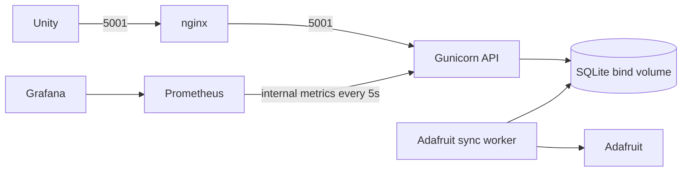

# IUH Campus Guardian

**Bảo vệ khuôn viên thông minh** — game phiêu lưu 3D kết hợp chiến đấu match-3 theo lượt, hướng đến **Windows PC và Android**.

Khám phá campus → quét nguồn nguyền → trận match-3 → thanh tẩy → nhận Campus Core → nâng cấp. Scene chính: `Assets/IUH_Campus/Scenes/IUH_SharedCampus_Concept.unity`. Cấu trúc chọn 6 minigame được thay bằng một game thống nhất.

## Thiết kế mục tiêu

- PC bật camera quét trong game để thấy khói tím và khối dữ liệu lỗi trên vật thể bị nguyền; raycast xác nhận mục tiêu.
- Android mở camera thật nhận diện vật thể tương ứng theo nhiệm vụ, rồi đóng camera về campus để mở trận. Không cần hiệu ứng bám trên đồ vật thật; webcam PC chưa cam kết.
- Trận màn hình ngang: **nhân vật trái, bàn cờ giữa, quái phải**. Đề xuất bàn 6×6, bốn ô kiếm/khiên/năng lượng/hồi phục, một Skill.
- Đổi sai không mất lượt; chuỗi rơi trong cùng lượt, quái báo trước và phản công sau khi bàn ổn định; hết nước đi tự xáo.
- **Campus Core** nâng Tấn công, Phòng thủ, Sinh lực; mỗi nhánh 2 cấp bản đầu, chỉ mua ngoài trận. Bỏ EXP; trang phục/ngoại hình là mở rộng sau.
- Lưu Core, nâng cấp và khu vực thanh tẩy; chống thưởng trùng theo mốc và sự kiện. Hai nền tảng chưa bao gồm tài khoản/cloud save giữa thiết bị.

## Trạng thái và tài liệu

Cập nhật 01/11/2026: đang chuyển hướng thiết kế. PR tài liệu này không triển khai gameplay hoặc xác nhận Guardian đã chạy trên hai nền tảng. Checkout làm việc có dọn scene/menu local nhưng flow/UI cũ vẫn cần chuyển đổi; không dùng bằng chứng minigame cũ cho Guardian.

- [Kế hoạch chi tiết, phân công đề xuất và nghiệm thu](plan.md).
- [Tóm tắt gửi nhóm và rubric gốc](plan.txt).
- [Báo cáo đề xuất đã cập nhật](Docs/IUH_Campus_Guardian_Bao_Cao_De_Xuat.docx).
- [Dashboard cũ](IUH_Plan_Dashboard.html) chưa phản ánh thiết kế mới.

## Mở project và backend hiện có

Mở repository bằng Unity Hub với **Unity 6000.5.8f1** theo `ProjectSettings/ProjectVersion.txt`. Android cần Android Build Support/SDK/NDK/OpenJDK phù hợp. Mở scene SharedCampus ở trên, chờ import và kiểm tra Console trước Play. Không chạy builder cũ để tái tạo campus. Giữ `.meta` với asset; audit dependency trước khi xóa scene/script/pack.

### Chạy backend W9 B2 — YOLOv8n ONNX + Flask/Gunicorn

Backend runtime dùng Python 3.11, cổng **5001**, không cài torch. Model pretrained COCO `Server/models/yolov8n.onnx` được commit (~12,85 MB), không train lại. License Ultralytics **AGPL-3.0**, bản license và SHA256 nằm trong `Server/models/README.md`.

```powershell
python -m venv Server/.venv
.\Server\.venv\Scripts\python.exe -m pip install -r Server/requirements-dev.txt
Copy-Item Server/.env.example Server/.env
```

Local: sửa `MODEL_PATH` trong `Server/.env` thành đường dẫn tuyệt đối tới `Server/models/yolov8n.onnx`. Docker giữ mặc định `/app/models/yolov8n.onnx`. Không commit `.env` hoặc key thật. Lớp nhiệm vụ mặc định: `book,laptop,chair,bottle,backpack,cell phone`; đổi bằng `ALLOWED_CLASSES`. ID được giải từ metadata model, không ánh xạ ID thủ công. Ngưỡng tối thiểu `CONFIDENCE_THRESHOLD=0.70`, ORT CPU dùng `ORT_INTRA_OP_THREADS=2` mặc định.

```powershell
.\Server\.venv\Scripts\python.exe -m flask --app Server/wsgi.py run --host 127.0.0.1 --port 5001
.\Server\.venv\Scripts\python.exe -m pytest Server/tests -q
docker compose -f Server/docker-compose.yml up -d --build
curl.exe http://localhost:5001/health
curl.exe -F "image=@Server/tests/fixtures/laptop-stocksnap.jpg" -F "target_class=laptop" http://localhost:5001/predict
curl.exe http://localhost:5001/metrics
docker compose -f Server/docker-compose.yml ps
docker compose -f Server/docker-compose.yml logs --tail 50
docker compose -f Server/docker-compose.yml down
```

Flask development server chỉ dùng thử local; Gunicorn chạy trong Linux/Docker. Compose >= 2.24.0 hỗ trợ `.env` tùy chọn qua `required: false`; Compose cũ cần nâng cấp hoặc copy `.env.example` rồi dùng `env_file: - .env`. Container mount `Server/models` chỉ đọc. Dockerfile multi-arch Python slim; B2 kiểm chứng môi trường linux/amd64, chưa nghiệm thu arm64.

**Export lại model** trong venv riêng (torch CPU không vào runtime image):

```powershell
python -m venv Server/.venv-export
.\Server\.venv-export\Scripts\python.exe -m pip install -r Server/requirements-export.txt
.\Server\.venv-export\Scripts\python.exe Server/export_onnx.py
.\Server\.venv\Scripts\python.exe Server/benchmark.py --model Server/models/yolov8n.onnx --image Server/tests/fixtures/laptop-stocksnap.jpg
```

Export 640, batch 1, opset 17, simplify; in MB/SHA256/shape/classes và tạo `yolov8n.classes.json` từ metadata. `--imgsz 480` hoặc `416` tạo model riêng để so sánh, không đổi mặc định 640. Benchmark: 5 warm-up + 50 lượt, p50/p95/mean của session.run và pipeline. Đo trong container bằng `docker compose exec` sau khi copy fixture vào `/tmp`; xem lệnh/output đầy đủ trong Evidence B2.

**POST /predict**: multipart field `image`, tùy chọn `target_class` và `threshold`. Threshold phải hữu hạn, từ ngưỡng cấu hình đến 1. Chỉ trả lớp cho phép với confidence đạt ngưỡng. Letterbox RGB 640, normalize float32 NCHW, NMS theo lớp, bbox pixel ảnh gốc. Không tự xoay theo EXIF; client gửi ảnh đúng hướng. Ảnh lớn được resize về kích thước input trước session.run.

| Field JSON 200 | Ý nghĩa |
|---|---|
| `detections[]` | `label`, `class_id`, `confidence`, `bbox:[x,y,w,h]`; góc trên-trái, pixel ảnh gốc |
| `target_class` | Lớp được yêu cầu hoặc null |
| `target_found` | Có detection khớp target ở ngưỡng; false nếu không truyền target |
| `best_confidence` | Confidence cao nhất khớp target, hoặc cao nhất toàn bộ khi target null; null nếu không có |
| `threshold` | Ngưỡng thực tế dùng |
| `image_size` | `[width,height]` pixel ảnh gốc |
| `inference_time_ms` | Chỉ thời gian `session.run` |
| `total_time_ms` | Parse/đọc ảnh + tiền xử lý + inference + hậu xử lý, không gồm network |
| `model` | `name` và `sha256_prefix` 8 ký tự |

Lỗi JSON: thiếu/ảnh không đọc được, target/threshold sai → 400; upload trên 5 MiB → 413; chưa nạp model → 503 `model_not_loaded`. `/health` 200 là liveness, cần kiểm tra thêm `model_loaded`; uptime là số giây từ lúc worker tạo app. Mỗi worker nạp session một lần. Không còn endpoint giả lập student-card/parking hay `/docs` FastAPI.

`/metrics`: request count theo status, HTTP latency, `model_loaded` (min của worker sống), `inference_seconds`, `detections_total{label}`, `predict_target_found_total`. Multiprocess exporter gom hai worker Gunicorn; master dọn database metrics cũ trong thư mục tạm, `child_exit` loại gauge worker chết. Không log INFO theo từng inference ngoài access log.

B1 đã nghiệm thu Docker; B2 chạy inference và ghi benchmark thật tại `Docs/Evidence/CampusGuardian/B2/`. YOLOv8n 640: API total p50 ≤ 150 ms, p95 ≤ 220 ms trên CPU (Ryzen 7 6800H, Docker, Gunicorn 2 worker); confidence ≥ 0.70. Ưu tiên độ chính xác; 416 nhanh hơn nhưng trượt nhiều hơn trên mẫu thử B2. Không suy ra đạt chỉ tiêu từ việc model đã chạy; xem số liệu và tradeoff 640/480/416 trong evidence. Adafruit IO chưa tích hợp ở B2. Điện thoại cần IP LAN/URL backend, không dùng localhost của PC.

### Gameplay events và Adafruit IO (B3)

B3 bổ sung `POST /gameplay/events` và `GET /gameplay/events/{event_id}`, lưu SQLite bền vững và sync service riêng. Không gửi Adafruit trong request handler. Tạo `.env` từ `Server/.env.example`, điền username/key trên máy; không đưa key vào Unity/Git/log. Local cần DATABASE_PATH trong Server/data; Docker mount `./data:/app/data`. File DB/WAL được ignore, giữ `.gitkeep`.

```powershell
docker compose -f Server/docker-compose.yml up -d --build
docker compose -f Server/docker-compose.yml exec -T iuh-guardian-api python setup_feeds.py
```

| API / trường | Quy tắc |
|---|---|
| POST /gameplay/events | JSON ≤16 KiB; event_id/session_id UUID; quest_id/milestone_id ASCII `[A-Za-z0-9_-]` ≤64; event_type; occurred_at ISO8601 có timezone, không quá tương lai 5 phút |
| scan_confirmed | payload chỉ có label thuộc lớp cho phép và confidence từ ngưỡng cấu hình đến 1 |
| combat_won / combat_lost | Không payload hoặc `{}`; không nhận Core/thưởng từ client |
| upgrade_purchased | payload chỉ có branch attack/defense/vitality, level nguyên 1..2 |
| 201 recorded | core_awarded do server tính; cloud pending hoặc disabled |
| 200 duplicate | Giữ thưởng lần đầu, trả cloud hiện tại; cùng ID/nội dung khác →409 event_id_conflict |
| GET /gameplay/events/{UUID} | Trạng thái hiện tại;404 nếu chưa ghi nhận; lỗi validate trả JSON error/field |

`Server/config/rewards.json` hiện tạm `library_intro: 10 Core`, **chờ nhóm chốt**. Chỉ thắng lần đầu mỗi `(session_id,milestone_id)` có thưởng; event + mốc thưởng + aggregate + outbox ghi nguyên tử. `campus_core_total` là tổng Core đã trao, chưa phải số dư mua nâng cấp; B3 ghi telemetry nâng cấp, chưa triển khai giá/trừ Core hay xác thực người chơi.

Cloud: pending → synced chỉ sau khi tất cả outbox liên quan đã được Adafruit chấp nhận (hoặc gộp vào tổng mới hơn đã ACK); tối đa8 lần retry rồi failed. Thiếu một trong hai credential → disabled, event vẫn ghi; không tự backfill các event disabled cũ. Sync service gộp giá trị tổng theo feed, gửi cách nhau ít nhất3,1 giây, không quá20 điểm/phút; backoff5s tăng mũ đến5 phút,429 tôn trọng Retry-After. Free tier có hạn30 điểm/phút cho cả tài khoản, kể cả publisher khác.

Bốn feed: `guardian-quests-completed`, `guardian-campus-core`, `guardian-upgrades`, `lost-found-count` (=scans_confirmed). `/health` có db_ok/cloud_configured/outbox_pending/outbox_failed; `/metrics` có gameplay_events_total/cloud_sync_total/outbox_pending. Chi tiết schema/giới hạn tại `Server/README.md`. Bằng chứng backend/cloud thật: `Docs/Evidence/CampusGuardian/B3/`; event mẫu là telemetry kiểm thử thủ công, chưa chứng minh Unity đã tích hợp. Người dùng chụp dashboard Adafruit riêng cho hồ sơ.

## Cloud và rubric

Mục tiêu: Unity → Flask kiểm tra/chống trùng sự kiện → Adafruit IO/dashboard. Key chỉ ở biến môi trường backend, không trong Unity/Git/log. Mất mạng vẫn chơi, lưu pending và retry có kiểm soát. Không cảm biến vật lý, không EXP/feed EXP.

Raycast PC không phải Deep Learning; nhận diện Android/overlay tím chưa tự đáp ứng AR. Nhóm cần chốt minh họa AR trên thiết bị tương thích và xác nhận yêu cầu AR/IO Cloud với giảng viên. Chỉ báo hoàn thành khi có bằng chứng thật.

## Lộ trình và phối hợp

Ba tuần: tuần 1 có hai build/quét/bàn cờ thử; tuần 2 hoàn thành combat/nâng cấp/cloud; tuần 3 test/tối ưu/build cuối/báo cáo. Một tuyến nhiệm vụ, một loại quái, một thử thách cao hơn sau nâng cấp là phạm vi bản đầu.

Đề xuất Gia Thịnh phụ trách Unity/gameplay/tích hợp AI/AR/hai build; Minh Nhật phụ trách backend/cloud/Docker/chống trùng và hỗ trợ UI/QA. Nhóm xác nhận, cân đối cuối tuần 1. Một người tích hợp scene tại một thời điểm; code/prefab qua PR.

Kiểm thử cả chuột lẫn cảm ứng, camera đúng/sai/quyền, chuỗi ghép và xáo, lượt quái/Skill, mua nâng cấp/thưởng lặp, lưu/restart/mất mạng, Docker/feed và checkout sạch. Ghi thiết bị, commit/build, Pass/Fail; bằng chứng mới dự kiến tại `Docs/Evidence/CampusGuardian/`.


## B4 monitoring stack



Five services: nginx, iuh-guardian-api, iuh-guardian-sync, prometheus, grafana.
Copy .env.example to .env and set GRAFANA_ADMIN_PASSWORD to a private nonempty password before `docker compose up -d --build` in Server/. Missing/empty password fails Compose interpolation; no admin/admin default. Never share `docker compose config` or container inspect output because they contain resolved credentials. The local .env is ignored. Grafana preserves its initialized credentials in its named volume; changing .env alone does not reset an existing admin password.

Ports: public API stays http://localhost:5001 through nginx; API has no host-published port. External /metrics returns404; internal Prometheus scrapes http://iuh-guardian-api:5001/metrics every5s, retaining7days. Nginx allows6MiB multipart requests; Flask still enforces5MiB with413JSON. Above6MiB nginx returns its own413. ProxyFix trusts exactly one X-Forwarded-For/Proto hop; nginx overwrites incoming client forwarding headers. HTTP only for local demo; TLS is deployment work.

Prometheus http://127.0.0.1:9090; Grafana http://127.0.0.1:3000. Both bind only loopback. Grafana permits anonymous Viewer demo access; administrator username admin uses the private .env password. Datasource Prometheus and dashboard "IUH Campus Guardian — API" provision automatically. Data persists in named prometheus_data/grafana_data volumes; do not use down -v to preserve monitoring history.

Cloud metrics use option(a): API custom collector reads shared SQLite sync_stats/outbox on every scrape, so separate sync worker data appears without starting another metrics server. Request rate uses duration_count with path/status labels (flask_http_request_total lacks path). Target-found ratio is successful /predict requests with a target match divided by all successful /predict requests, including calls with no target. Detections/gameplay show five-minute increases; cloud_sync_total shows durable cumulative totals. Quantiles require traffic and may be NaN when idle. Histogram quantiles are bucket estimates.

Generate opt-in demo data: `python tools/demo_traffic.py` (60seconds, new UUIDs, quest_id=demo_traffic, scan telemetry only). It posts at most20events/minute, while persistent outbox independently caps Adafruit sends to20points/minute. Each event may affect four feeds, so queue coalescing can occur. These are manual demo events, not verified game actions, and change scan totals on real Adafruit feeds. Capture the Grafana dashboard screenshot for the report after running traffic.


## B6 — Phiên quét đồ bị nhiễm

Model640/ngưỡng0.70 và schema `/predict` cũ được giữ nguyên khi không gửi scan_session_id. Dùng game session UUID tạo một lượt scan; backend chọn ngẫu nhiên bảo mật1..2lớp từ SCAN_INFECTED_POOL bằng secrets.SystemRandom, chỉ lưu trong SQLite và trả gợi ý tiếng Việt. SCAN_INFECTED_MIN/MAX mặc định1/2 (chỉ cho1..2), SCAN_SESSION_TTL_MINUTES=15. Mapping gợi ý ở config/scan_hints.json. Không có API/log/metrics nào xuất danh sách lớp nhiễm chưa reveal.

| API | Request | Response |
|---|---|---|
| POST /scan/sessions | JSON {session_id: UUID game}; chỉ field này, body≤16KiB |201 {scan_session_id,hint,max_monsters,expires_at};400validation |
| GET /scan/sessions/{id} | scan UUID |200 {scan_session_id,hint,monsters_remaining,expires_at,revealed_count};404scan_session_not_found;410scan_session_expired |
| POST /predict | multipart image + tùy chọn scan_session_id |200response cũ + scan{label,result,monster_token,monsters_remaining};404/410 như trên |
| POST /gameplay/events | combat_won thêm tùy chọn payload{monster_token} |201thưởng cấu hình ar_monster (tạm10);200duplicate cùng event_id/nội dung;400invalid_monster_token;409event_id_conflict |

Ví dụ luồng: POST /scan/sessions {"session_id":"UUID-game"} → giữ scan_session_id/hint → chụpảnh → POST /predict(image,scan_session_id). `scan.label` là detection tốt nhất thuộc lớp cho phép và đạt threshold; null khi không có. `infested` trả token để mở trận; `clean`/`none` không có token. Nó dùng detection tốt nhất trên tất cả lớp cho phép, không phụ thuộc target_class; client scan nên bỏ target_class. Khi thắng, gửi eventUUID mới, session_id=UUID-game ban đầu, quest_id do game chọn, milestone_id=ar_monster, event_type=combat_won, occurred_at UTC và payload{monster_token}. Client không gửi Core. Giữ nguyên event_id/JSON khi retry.

Mỗi lớp nhiễm chỉ sinh một token trong một scan session, quét lại trả token cũ; monsters_remaining là số lớp còn chưa reveal (không phải số quái chưa đánh). Cùng event_id có nội dung giống nhậnDuplicate/originalCore; event_id mới dùng token đã thưởng trả400. Token sai/khác game session/chưa reveal đều400. Token đã reveal vẫn có thể nộp kết quả sau khi TTL hết, nhưng chỉ thưởng một lần; TTL ngăn scan/reveal mới. Không token giữ đúng luật milestone B3; key mới ar_monster được dành riêng cho token (gửi ar_monster không token trả400), tránh xin thêm thưởng theo nhánh legacy. CombatLost/scan_confirmed không nhận monster_token; monster_revealed là event server nội bộ, client gửi loại này bị400.

SQLite migration cộng thêm scan_sessions, scan_reveals, scan_stats và aggregates.monsters_revealed, không xóa dữ liệu cũ. BEGIN IMMEDIATE + UNIQUE(scan_session_id,label)/UNIQUE(monster_token) gộp nguyên tử reveal + internal event + aggregate + outbox; token claim thưởng/event/Core nằm trong transaction chung và an toàn2worker/restart. Event nội bộ chỉ có lớp đã reveal, không chứa danh sách bí mật. Chỉ guardian-monsters-revealed được queue khi reveal mới;4feed cũ vẫn cập nhật bằng events cũ/thưởng. setup_feeds.py đảm bảo5feed của app (≤10free tier); tài khoản dùng chung project khác vẫn chia sẻ quota. Syncworker giữ≤20điểm/phút, retry/coalesce nhưB3.

Metrics bền vững từ SQLite: scan_sessions_total, scan_results_total{result=infested|clean|none}, monsters_revealed_total{label}; không có scan/session/token labels. HTTP histogram vẫn giữ keypath nhưng giá trị là route template (/scan/sessions/<scan_id>), không UUID. Hai panel mới: Scan result ratio và Monsters revealed by object; default dashboarduidguardian-api có tổng11panel. Grafana/Prometheus vẫn chỉbind127.0.0.1; /metrics bịchặn qua nginx.

Giới hạn chống farm: ràng buộc1..2quái và thưởngmộtlần áp dụng **mỗi scan session/token**; POSTtạo phiên mới là một lượt mới. API chưa xác thực tài khoản hoặc chứng minh trận thắng, UUIDgame do client cấp; tạo vô hạn UUID/phiên mới chưa được chặn bởi account/rate quota trong B6. Không coi token là cơ chế chống gian lận toàn cục. Cần nhóm chốt giới hạn lượt mới theo người chơi trước khi mở public; B6 không tự đặt chính sách ngày/tài khoản. Không đổi quy tắc milestone cũ.

Unity: B5 chưa có StartScanSessionAsync/GetScanSessionAsync hoặc DTO scan/monster_token. Thịnh/Minh Nhật cần thêm sau: giữ game UUID ổn định, hiển thịhint, gửi scan_session_id cùng JPG, chặn mở lại cùngtoken, lưu token đểCombatWon, xử lý404/410và monsters_remaining; tích hợpAR plane/monster/match3 riêng. B6 không sửaAssets/scene hoặc khai báo đã cóAR.

Nghiệm thu opt-in: python tools/b6_smoke.py (Docker stack chạy). Script thử tối đa12lượt random với fixture laptop có license, mỗi lượt game UUIDkhác, không đọc DB/lớp bí mật; dừng khiinfested hoặc thoát2nếu không trúng, không bịa. Chỉ một token tìm thấy được gửicombat_won demo, quest_id=B6_smoke; lần2Duplicate vàeventmới dùngtokencũ400. Đây là telemetry thủ công, có thể tăngfeed/Core thật; không phải trận thắng được xác minh. Evidence ởDocs/Evidence/CampusGuardian/B6/. Chụp2panelGrafana bằngtay saukhi cótraffic.

### B2.8 — Pool lớp có thể bị nhiễm

`SCAN_INFECTED_POOL=cell phone,laptop,chair` (mặc định trong env, mẫu ở `Server/.env.example`): đồ có thể bị nhiễm là **điện thoại, laptop, ghế**. Chọn ba lớp này vì recall B2.6 tại 0.70 tốt hơn book/bottle/backpack trên mẫu nhỏ; xem [kết quả ảnh thật](Docs/Evidence/CampusGuardian/B2/real-eval.md).

Giữ YOLOv8n 640 và ngưỡng 0.70; `/predict` vẫn nhận đủ sáu lớp, nhưng book/bottle/backpack trả `scan.result=clean` khi được phát hiện với scan_session_id và pool mặc định. Mỗi phiên chọn 1–2 lớp, không vượt số lớp duy nhất trong pool; pool rỗng hoặc có tên ngoài ALLOWED_CLASSES làm backend lỗi khởi động rõ ràng. Gợi ý laptop/cell phone = “đồ điện tử”, chair = “thứ để ngồi”; hai lớp điện tử chỉ hiện một cụm gợi ý. Không sửa `.env` thật; cấu hình qua môi trường backend. Các phiên SQLite cũ giữ thời hạn và gợi ý đã lưu; lớp ngoài pool hiện tại không được reveal thêm, nên bắt đầu phiên mới sau khi đổi pool.
