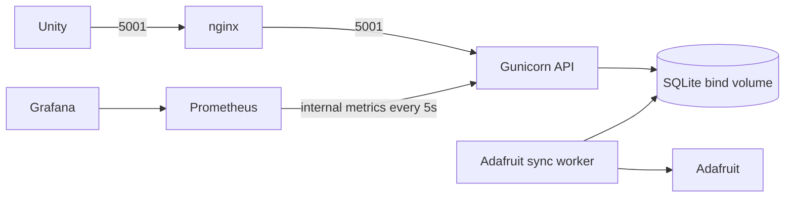

# Backend runtime tuning / real-photo evaluation (B2.5)

The deployed model remains `models/yolov8n.onnx` (640 FP32), confidence minimum 0.70. No smaller or quantized model and no experimental threshold is applied automatically.

## ONNX Runtime

`ORT_INTRA_THREADS` replaces `ORT_INTRA_OP_THREADS`. Leave it empty for `max(1, available logical CPU count // WEB_CONCURRENCY)`. CPU affinity is respected where supported. `WEB_CONCURRENCY` defaults to 2 and controls actual Gunicorn workers. On Windows the CPU fallback uses `os.cpu_count()`. Counts are logical CPUs, not physical cores; cgroup CPU quotas are not inferred separately.

Sessions explicitly use graph optimization `ORT_ENABLE_ALL`, execution mode `ORT_SEQUENTIAL`, inter-op threads 1. `.env.example` shows the automatic setting. Set an explicit thread count only after measuring the target machine.

## Benchmark commands

Run from `Server/` using the runtime venv:

```powershell
.\.venv\Scripts\python.exe -m tools.benchmark_tuning --mode local --threads 4 --workers 2
.\.venv\Scripts\python.exe -m tools.benchmark_tuning --mode http --workers 2 --url http://localhost:5001
.\.venv\Scripts\python.exe -m tools.benchmark_tuning --mode http --workers 2 --seconds 30
```

Local Windows uses 1/2 actual worker processes, each with an independent model session and Flask test client; it does not claim to run native Gunicorn. Container HTTP tests use actual Gunicorn configured with matching `WEB_CONCURRENCY` and `ORT_INTRA_THREADS`; client concurrency equals worker count. Each local worker/HTTP client warms up 5 requests then measures 50. The load scenario warms up first, then sends two closed-loop HTTP streams for 30 seconds. A final in-flight response may finish slightly after the deadline. `total_time_ms` comes from the API, while `wall_ms` includes HTTP/client overhead. Local elapsed/throughput also includes process startup and warmup; compare per-request latency percentiles for tuning.

Experimental models are generated separately:

```powershell
.\.venv-export\Scripts\python.exe export_onnx.py --imgsz 512
.\.venv-export\Scripts\python.exe export_onnx.py --imgsz 480
.\.venv-export\Scripts\python.exe export_onnx.py --imgsz 416
.\.venv-export\Scripts\python.exe -m tools.quantize_trial
```

Dynamic signed INT8 uses ONNX Runtime `quantize_dynamic(..., weight_type=QInt8)`. A successful quantization does not mean the CPU execution provider supports every output operator. Unsupported models are reported unavailable; no latency/accuracy value is invented and no runtime package is patched. Model 512 and INT8 artifacts remain local/ignored, not defaults.

## Real photos (not yet supplied)

```powershell
.\.venv\Scripts\python.exe eval_real.py --threads 4
```

Expected directory: `Server/tests/fixtures/real/`. Filename prefix before `_` is the user-confirmed image-level target: `book`, `laptop`, `chair`, `bottle`, `backpack`, `cellphone` maps to `cell phone`, and `none` means no allowed target class. Other names are listed and skipped. The script generates `labels.csv`, then evaluates 640/512/480/416 FP32 and dynamic INT8 at 0.50/0.60/0.70 in a pure detector experiment; production API minimum stays 0.70. Five warmups precede each model/threshold evaluation. Recall is image-level per class, and false positives count `none` images with any allowed detection. p50 includes local file/image decoding and model pipeline, not HTTP.

Output: `Docs/Evidence/CampusGuardian/B2/real-eval.md` and a JSON detail file. Missing/empty/unlabelled directories print instructions and exit 2 without a traceback. A report with N/A rows is written instead of fabricated measurements. No photos are created or modified by evaluation.

Before any future photo commit, manually inspect people and personal information; exclude such photos, resize approved copies to a maximum 1280px edge, and strip EXIF/GPS. This tooling does not certify privacy automatically. B2's stock/synthetic fixtures are only speed inputs for this turn, not a replacement for user-shot accuracy evaluation.


## Gameplay events and durable cloud outbox (B3)

Create `Server/.env` from `.env.example`, fill credentials locally, and never commit/print them. Local development should set DATABASE_PATH to an absolute path under Server/data; Docker uses /app/data/guardian.db with ./data:/app/data. On Linux the bind directory must be writable by container UID10001 (prepare ownership before startup). Back up the database together with its WAL using SQLite backup tooling; do not delete a live database to reset telemetry.

```powershell
docker compose -f Server/docker-compose.yml up -d --build
docker compose -f Server/docker-compose.yml exec -T iuh-guardian-api python setup_feeds.py
```

`setup_feeds.py` GETs each of the four named feeds and creates only missing feeds. It prints fixed feed names/statuses and credentials=****, never credentials or raw HTTP error bodies. API/sync share the image and SQLite data volume; sync is a separate process/container (`python -m app.sync_worker`), with no sender thread in Gunicorn.

### API contract

| Endpoint | Result |
|---|---|
| POST /gameplay/events | 201 recorded; 200 identical duplicate; 409 event_id_conflict; 400 validation error with error/field |
| GET /gameplay/events/{UUID} | Current event_id/core_awarded/cloud; 404 when missing |

Required fields: event_id UUID, session_id UUID, quest_id and milestone_id matching [A-Za-z0-9_-] (1..64 chars), event_type, occurred_at ISO8601 with timezone. UUIDs/timezones are canonicalized for payload hashing. Future time over5min is rejected, old timestamps are accepted, body limit16KiB. No client Core/price/reward field is accepted, including inside payload.

| event_type | payload whitelist |
|---|---|
| scan_confirmed | label from ALLOWED_CLASSES; finite confidence from configured minimum0.70 through1 |
| combat_won / combat_lost | Omit payload or use empty object |
| upgrade_purchased | branch attack/defense/vitality, integer level1..2 |

Temporary reward: config/rewards.json contains library_intro=10 Core, awaiting team approval. Unknown combat-win milestones return400. Only the first win for each (session_id,milestone_id) grants Core/increments quests_completed. Other distinct events award0. A duplicate event_id returns the original award and current cloud status, even after restart. An identical event with a new ID is a new telemetry event; scan/upgrade aggregates count recorded events. B3 does not debit a purchase balance or authorize purchases; campus_core_total is lifetime awarded Core. Authentication, stable session identity and purchase authorization remain integration work; a client-supplied UUID is not an account identity.

Cloud status: pending while any linked outbox row is pending/inflight; synced only when all linked rows succeeded; failed if any is terminally failed; disabled for events recorded without both credential fields. Disabled historical events are not backfilled automatically. Request handlers only commit locally and never call Adafruit.

### Transaction and retry semantics

SQLite WAL, busy_timeout10s, BEGIN IMMEDIATE and primary/unique constraints serialize concurrent writers. Event, first-milestone marker, aggregate and outbox links commit atomically. Every cloud-enabled event links all four aggregate feeds: guardian-quests-completed, guardian-campus-core, guardian-upgrades, lost-found-count (=scans_confirmed). Pending unclaimed values coalesce to the latest total; links of affected events are retained/remapped before deleting superseded queue rows.

The separate sync process atomically claims with a random token and30s lease; a persistent global send gate serializes senders. Requests use HTTPS header X-AIO-Key, timeout5s and no redirects. No raw exception/response body is logged or stored. Backoff5/10/20/... <=300s, max8 attempts including crash recovery;429 respects Retry-After (seconds/date), even when longer than the normal backoff. Terminal rows remain failed. Send spacing is at least3.1s after completion: at most20 data points/minute, under the free-tier30 limit. Other account publishers still share Adafruit's account quota.

SQLite reward/event dedupe is exactly once for the specified keys. External HTTP delivery is at least once: a crash after Adafruit accepts a point but before local ACK can repeat the same total. Totals do not increment reward again. This implementation does not claim an impossible cross-service exactly-once transaction.

/health adds db_ok, cloud_configured, outbox_pending, outbox_failed; DB failure returns503 with unavailable counts null. /metrics adds gameplay_events_total{type,result}, cloud_sync_total{result} and outbox_pending. Cloud metrics are collected from durable SQLite stats rather than an unshared metrics directory in the sync container, so API metrics reflect the sync service and survive restarts. SQLite data and Prometheus multiprocess mmap files must stay in separate directories.

Tests isolate credentials/databases and deny live network. Live acceptance is explicitly opt-in: live_cloud_check.py sends manual sample telemetry, not claims of actual camera/gameplay integration. Evidence: Docs/Evidence/CampusGuardian/B3/. Capture Adafruit dashboard screenshots separately for the report.


## B4 monitoring stack



Five services: nginx, iuh-guardian-api, iuh-guardian-sync, prometheus, grafana.
Copy .env.example to .env and set GRAFANA_ADMIN_PASSWORD to a private nonempty password before `docker compose up -d --build` in Server/. Missing/empty password fails Compose interpolation; no admin/admin default. Never share `docker compose config` or container inspect output because they contain resolved credentials. The local .env is ignored. Grafana preserves its initialized credentials in its named volume; changing .env alone does not reset an existing admin password.

Ports: public API stays http://localhost:5001 through nginx; API has no host-published port. External /metrics returns404; internal Prometheus scrapes http://iuh-guardian-api:5001/metrics every5s, retaining7days. Nginx allows6MiB multipart requests; Flask still enforces5MiB with413JSON. Above6MiB nginx returns its own413. ProxyFix trusts exactly one X-Forwarded-For/Proto hop; nginx overwrites incoming client forwarding headers. HTTP only for local demo; TLS is deployment work.

Prometheus http://127.0.0.1:9090; Grafana http://127.0.0.1:3000. Both bind only loopback. Grafana permits anonymous Viewer demo access; administrator username admin uses the private .env password. Datasource Prometheus and dashboard "IUH Campus Guardian — API" provision automatically. Data persists in named prometheus_data/grafana_data volumes; do not use down -v to preserve monitoring history.

Cloud metrics use option(a): API custom collector reads shared SQLite sync_stats/outbox on every scrape, so separate sync worker data appears without starting another metrics server. Request rate uses duration_count with path/status labels (flask_http_request_total lacks path). Target-found ratio is successful /predict requests with a target match divided by all successful /predict requests, including calls with no target. Detections/gameplay show five-minute increases; cloud_sync_total shows durable cumulative totals. Quantiles require traffic and may be NaN when idle. Histogram quantiles are bucket estimates.

Generate opt-in demo data: `python tools/demo_traffic.py` (60seconds, new UUIDs, quest_id=demo_traffic, scan telemetry only). It posts at most20events/minute, while persistent outbox independently caps Adafruit sends to20points/minute. Each event may affect four feeds, so queue coalescing can occur. These are manual demo events, not verified game actions, and change scan totals on real Adafruit feeds. Capture the Grafana dashboard screenshot for the report after running traffic.


## B6 — Phiên quét đồ bị nhiễm

Model640/ngưỡng0.70 và schema `/predict` cũ được giữ nguyên khi không gửi scan_session_id. Dùng game session UUID tạo một lượt scan; backend chọn ngẫu nhiên bảo mật1..2lớp từ ALLOWED_CLASSES bằng secrets.SystemRandom, chỉ lưu trong SQLite và trả gợi ý tiếng Việt. SCAN_INFECTED_MIN/MAX mặc định1/2 (chỉ cho1..2), SCAN_SESSION_TTL_MINUTES=15. Mapping gợi ý ở config/scan_hints.json. Không có API/log/metrics nào xuất danh sách lớp nhiễm chưa reveal.

| API | Request | Response |
|---|---|---|
| POST /scan/sessions | JSON {session_id: UUID game}; chỉ field này, body≤16KiB |201 {scan_session_id,hint,max_monsters,expires_at};400validation |
| GET /scan/sessions/{id} | scan UUID |200 {scan_session_id,hint,monsters_remaining,expires_at,revealed_count};404scan_session_not_found;410scan_session_expired |
| POST /predict | multipart image + tùy chọn scan_session_id |200response cũ + scan{label,result,monster_token,monsters_remaining};404/410 như trên |
| POST /gameplay/events | combat_won thêm tùy chọn payload{monster_token} |201thưởng cấu hình ar_monster (tạm10);200duplicate cùng event_id/nội dung;400invalid_monster_token;409event_id_conflict |

Ví dụ luồng: POST /scan/sessions {"session_id":"UUID-game"} → giữ scan_session_id/hint → chụpảnh → POST /predict(image,scan_session_id). `scan.label` là detection tốt nhất thuộc lớp cho phép và đạt threshold; null khi không có. `infested` trả token để mở trận; `clean`/`none` không có token. Nó dùng detection tốt nhất trên tất cả lớp cho phép, không phụ thuộc target_class; client scan nên bỏ target_class. Khi thắng, gửi eventUUID mới, session_id=UUID-game ban đầu, quest_id do game chọn, milestone_id=ar_monster, event_type=combat_won, occurred_at UTC và payload{monster_token}. Client không gửi Core. Giữ nguyên event_id/JSON khi retry.

Mỗi lớp nhiễm chỉ sinh một token trong một scan session, quét lại trả token cũ; monsters_remaining là số lớp còn chưa reveal (không phải số quái chưa đánh). Cùng event_id có nội dung giống nhậnDuplicate/originalCore; event_id mới dùng token đã thưởng trả400. Token sai/khác game session/chưa reveal đều400. Token đã reveal vẫn có thể nộp kết quả sau khi TTL hết, nhưng chỉ thưởng một lần; TTL ngăn scan/reveal mới. Không token giữ đúng luật milestone B3; key mới ar_monster được dành riêng cho token (gửi ar_monster không token trả400), tránh xin thêm thưởng theo nhánh legacy. CombatLost/scan_confirmed không nhận monster_token; monster_revealed là event server nội bộ, client gửi loại này bị400.

SQLite migration cộng thêm scan_sessions, scan_reveals, scan_stats và aggregates.monsters_revealed, không xóa dữ liệu cũ. BEGIN IMMEDIATE + UNIQUE(scan_session_id,label)/UNIQUE(monster_token) gộp nguyên tử reveal + internal event + aggregate + outbox; token claim thưởng/event/Core nằm trong transaction chung và an toàn2worker/restart. Event nội bộ chỉ có lớp đã reveal, không chứa danh sách bí mật. Chỉ guardian-monsters-revealed được queue khi reveal mới;4feed cũ vẫn cập nhật bằng events cũ/thưởng. setup_feeds.py đảm bảo5feed của app (≤10free tier); tài khoản dùng chung project khác vẫn chia sẻ quota. Syncworker giữ≤20điểm/phút, retry/coalesce nhưB3.

Metrics bền vững từ SQLite: scan_sessions_total, scan_results_total{result=infested|clean|none}, monsters_revealed_total{label}; không có scan/session/token labels. HTTP histogram vẫn giữ keypath nhưng giá trị là route template (/scan/sessions/<scan_id>), không UUID. Hai panel mới: Scan result ratio và Monsters revealed by object; default dashboarduidguardian-api có tổng11panel. Grafana/Prometheus vẫn chỉbind127.0.0.1; /metrics bịchặn qua nginx.

Giới hạn chống farm: ràng buộc1..2quái và thưởngmộtlần áp dụng **mỗi scan session/token**; POSTtạo phiên mới là một lượt mới. API chưa xác thực tài khoản hoặc chứng minh trận thắng, UUIDgame do client cấp; tạo vô hạn UUID/phiên mới chưa được chặn bởi account/rate quota trong B6. Không coi token là cơ chế chống gian lận toàn cục. Cần nhóm chốt giới hạn lượt mới theo người chơi trước khi mở public; B6 không tự đặt chính sách ngày/tài khoản. Không đổi quy tắc milestone cũ.

Unity: B5 chưa có StartScanSessionAsync/GetScanSessionAsync hoặc DTO scan/monster_token. Thịnh/Minh Nhật cần thêm sau: giữ game UUID ổn định, hiển thịhint, gửi scan_session_id cùng JPG, chặn mở lại cùngtoken, lưu token đểCombatWon, xử lý404/410và monsters_remaining; tích hợpAR plane/monster/match3 riêng. B6 không sửaAssets/scene hoặc khai báo đã cóAR.

Nghiệm thu opt-in: python tools/b6_smoke.py (Docker stack chạy). Script thử tối đa12lượt random với fixture laptop có license, mỗi lượt game UUIDkhác, không đọc DB/lớp bí mật; dừng khiinfested hoặc thoát2nếu không trúng, không bịa. Chỉ một token tìm thấy được gửicombat_won demo, quest_id=B6_smoke; lần2Duplicate vàeventmới dùngtokencũ400. Đây là telemetry thủ công, có thể tăngfeed/Core thật; không phải trận thắng được xác minh. Evidence ởDocs/Evidence/CampusGuardian/B6/. Chụp2panelGrafana bằngtay saukhi cótraffic.
